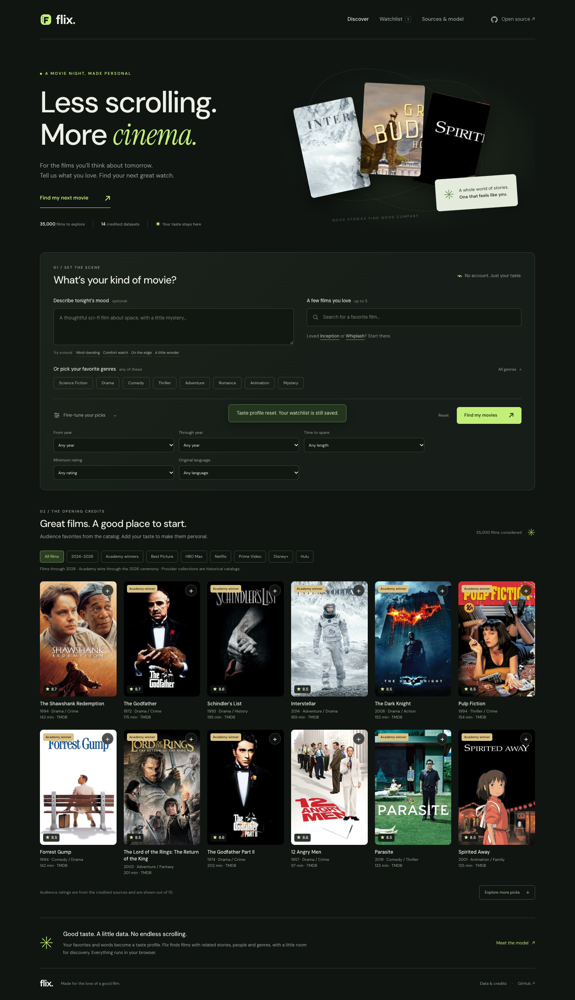

# Flix

Find your next great movie from your favorite films, a written mood and a few filters. Flix uses a real fitted content recommendation model, runs inference in your browser and keeps your preferences and watchlist on your device.

**Live app:** https://Shubin123.github.io/flix/  
**Public source:** https://github.com/Shubin123/flix



## What it does

- Accepts up to five favorite movies and a free-text description of what you want to watch.
- Finds related stories, genres, cast and directors, with explanations for each recommendation.
- Filters by release year, runtime, original language and source audience rating.
- Saves a local watchlist and lets you mark films as outside your taste.
- Browse collections: 2024–2026 releases, Academy Award winners, Best Picture winners, and historical HBO Max, Netflix, Prime Video, Disney+ and Hulu catalogs.
- Shows Academy Award wins with their human honorees, per-film source credits and all fourteen versioned dataset receipts in the app.

## Data and human credits

Fourteen public Kaggle datasets were downloaded: **531,152,869 bytes** of compressed archives. The pipeline processed **1,636,455 rows**, merged film records and selected **35,000 feature films** for the browser model. The catalog covers **1911–2026** and labels **1,039 Academy Award–winning films** through the **2026 ceremony**. Recent years are thinner (2024: 219, 2025: 149, 2026: 5 films) because only well-documented recent rows are kept. Every dataset contributes to the model.

Credit for collecting and publishing the datasets belongs to **asaniczka, Rounak Banik, Sohier Dane / The Movie Database, Harshit Shankhdhar, Shivam Bansal, Victor Soeiro, Ruchi Bhatia, DHRITI SISODIA and David Lu!!** (with lopcio, credited on the Oscar dataset). TMDB's community supplies the underlying TMDB movie metadata, Victor Soeiro identifies JustWatch as the original provider for his catalogs, and the Oscar data comes from the Academy of Motion Picture Arts and Sciences' awards database. Original movie artwork belongs to its respective rights holders.

See [complete source citations, creators and license notes](docs/SOURCES.md), [download receipts and SHA-256 checksums](data/download-manifest.json), and the [training report](docs/training-report.json). Raw archives and private credentials are excluded from Git.

## The model

The reproducible Python pipeline fits a **18,000-term TF-IDF vocabulary** on plots, genres, keywords, cast and directors. **Truncated SVD** learns 96 latent semantic dimensions. The browser combines cosine similarity in this learned space with up to 80 retained TF-IDF features per film, shared people, lexical overlap and a Bayesian source-rating prior. A small diversity adjustment reranks the shortlist.

Favorite films contribute to the taste profile, free text is projected using the fitted vocabulary and SVD components, and films marked as outside your taste reduce related themes. Recommendations are content similarities, **not predicted user ratings or calibrated probabilities**. There is no held-out user-preference accuracy claim. Sparse metadata, English plot text and source vote counts bias coverage. Genre filters accept any selected genre. Missing rating or language metadata cannot pass a filter requiring that field.

Inference uses JavaScript and typed arrays. Gzipped model assets are decoded with the browser's `DecompressionStream` API; a recent Chrome, Safari, Firefox or Edge is required. The first visit downloads about 27 MB of model data. There is no backend, API key or recommendation service.

## Run locally

With Node.js 22 or later:

```sh
npm ci
npm run dev
```

Open http://127.0.0.1:4173. Model artifacts are committed, so running the app does not require downloading or retraining the datasets.

```sh
npm test
npm run test:browser
npm run build
```

Browser checks use an installed Google Chrome, or the executable supplied in `FLIX_CHROME_BINARY`. Use `FLIX_BASE_URL` to validate the deployed site. `npm run build` copies the static app and verified model files to `dist/`.

## Reproduce the dataset and training pipeline

Use Python 3.13 or later. The fourteen versions are pinned in `data/sources.json`.

```sh
python3 -m venv .venv
.venv/bin/python -m pip install -r requirements.txt
.venv/bin/python scripts/download_data.py
.venv/bin/python scripts/train_model.py
npm test
npm run build
```

The public Kaggle download endpoints were accessible without authentication at retrieval. If Kaggle changes access or a source license, the downloader fails visibly. Allow several GB of disk space for archives and extracted metadata. MovieLens rating and link files are excluded from extraction and training. A seeded SVD makes training repeatable; small floating-point differences between platforms can change binary checksums.

## GitHub Pages

The public repository deploys from `main` using [.github/workflows/pages.yml](.github/workflows/pages.yml). The workflow verifies the committed model, runs the recommendation tests, builds the static site, uploads its Pages artifact and deploys it with GitHub's official Pages actions. All asset URLs are relative so the `/flix/` project path works.

## Privacy and terms

Preferences and watchlists stay in browser local storage. There is no analytics or account system. GitHub Pages, Google Fonts and TMDB receive normal requests to serve the site, fonts and images; preference text is not included in those requests. Clearing browser data removes saved preferences.

Streaming catalog memberships are **historical 2021–2022 snapshots**, not current availability. Audience ratings are not maturity ratings. This is a noncommercial discovery demo. The [MIT license](LICENSE) covers original code; [data and artwork retain their own terms](public/data/LICENSE.md), including ODC-By attribution and TMDB's noncommercial and branding requirements.

This product uses the TMDB API but is not endorsed or certified by TMDB.
